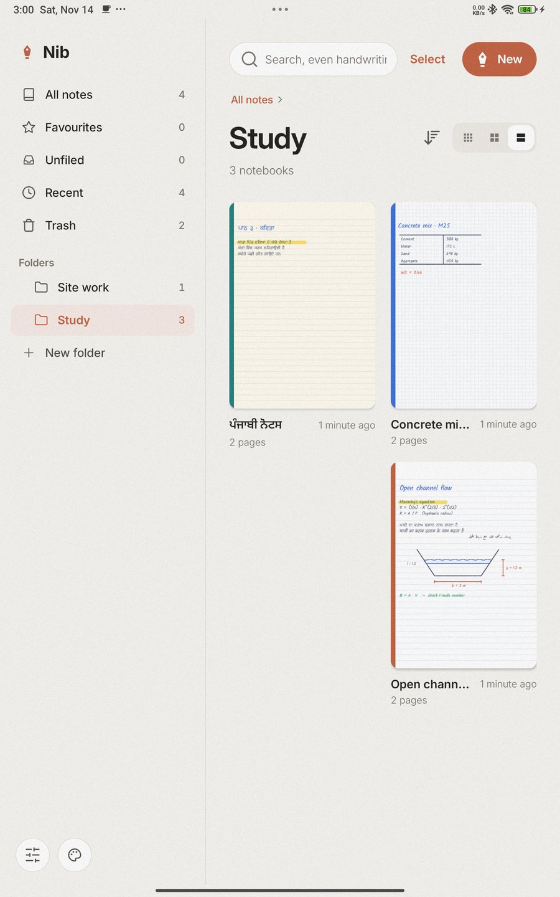
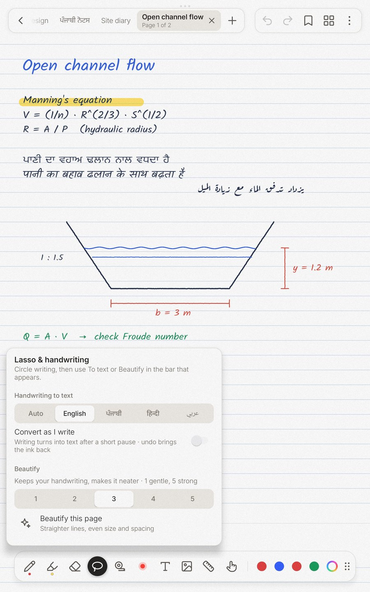
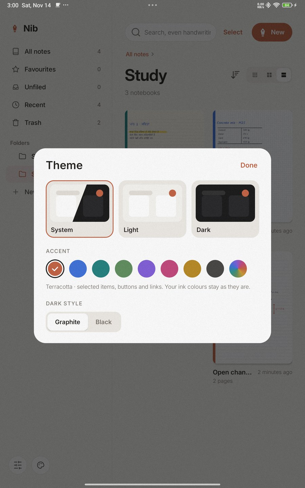
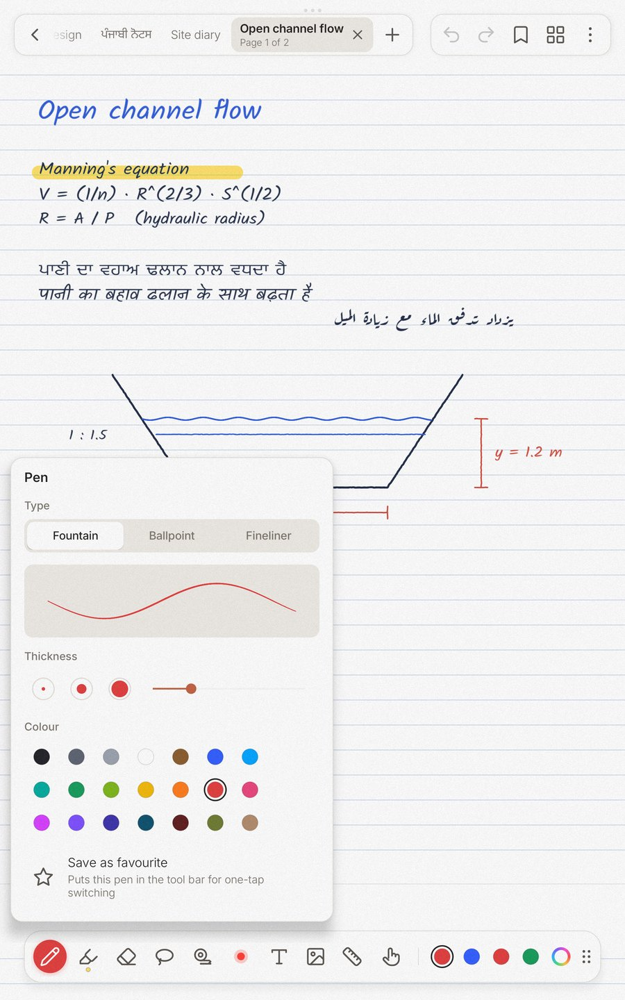

# Nib

**Low-latency handwritten notes for Android tablets.** Nib draws your ink straight into the display's front
buffer, so strokes appear under the pen tip with almost no lag. Around that sits a calm, distraction-free
notebook: pages that fill the screen, floating tools that can step aside while you write, tabs, split view,
and handwriting that turns into text in English, Punjabi, Hindi or Arabic.

<p>
  
  
</p>
<p>
  
  
</p>

## Features

**Writing**
- Front-buffer ink rendering (OpenGL ES) with optional stroke prediction: ink keeps up with the pen
- Fountain, ballpoint and fineliner pens with pressure; without pressure (finger, or a stylus that has none) the fountain pen tapers in and out like a real nib
- Customisable **5-slot colour palette** (spectrum, HEX and RGB picker) and **3 user-definable thickness slots** per tool (Pen, Highlighter, Shape, Eraser)
- Highlighter with a round or flat (chisel) tip that can straighten itself on lift
- Eraser: whole-stroke or partial; erased ink greys out and goes when the pen lifts; hold the pen still where it lands to erase without switching tools
- **Shapes & Design** toolbar with 14 editable vector shapes (freeform, rectangle, rounded rectangle, circle, ellipse, triangle, polygon, line, single & double arrows, curve, speech bubble, bracket, brace), 4 fill styles (no fill, solid, translucent, custom), independent border/fill opacity, corner radius, arrowhead sizing, rotation/vertex handles, and layer stacking order (behind or in front of handwriting)
- Hold the pen still to snap lines, circles, ellipses, triangles, rectangles and quadrilaterals straight into editable shapes with full **Shape Style** and **Order** controls; keep moving while holding to stretch or resize
- Interactive per-document **Grid overlay** with live preview, custom spacing/presets, styling, margins, and optional **Snap to grid** (never included in exports)
- Ruler with angle readout and real-world drawing scales (1:100 …)
- Lasso: circle or cross any part of strokes or shapes to select, move, scale, recolour, style, copy, cut, duplicate or delete; also selects text boxes and images
- **Canvas video & voice recording**: hardware-accelerated canvas-only MP4 + microphone recording (720p, 1080p, 1440p or Canvas; 30/60 fps; pause/resume & live mic mute) that never captures toolbars or system UI
- Laser pointer, never saved: fading trail, dot, or vanishing ink; six colours, three sizes; can follow the hovering pen
- Tape for studying: cover answers with straight or freeform tape, tap to peel it back, tap again to cover
- Customisable **stylus side buttons** (Primary & Secondary): assign any of 20 actions, including cycling pen colours, cycling your chosen drawing tools, switching tools, or Undo/Redo
- Write with your finger too (one toggle); two fingers scroll and zoom
- Favourite pens in the tool bar, one tap to switch; drag the tool bar to the bottom, top, left or right edge

**Handwriting to text**
- Lasso your writing → **To text**: check and edit what was read, then it replaces the ink with a text box in a handwriting face
- **Convert as I write**: writing turns into text after a short pause; words on the same line join one box, and matras, dots or a top line added afterwards are read again with their word
- English, Punjabi (Gurmukhi), Hindi (Devanagari) and Arabic, or **Auto**: the shape of the line picks the script, the models' confidence picks the language
- Converted text keeps its handwriting: read it again in another language, or turn it back into ink
- **Beautify** keeps your own handwriting and makes it neater: straight lines on the ruled lines, even size and spacing, less wobble
- Everything in one panel: tap the lasso tool again

**Text**
- Text boxes in Inter, Serif, Mono or Handwriting, or your own fonts: import any .ttf or .otf (they're included in backups)
- Style selected words or the whole box: font, size in points, bold, italic, underline, strike-through and colour; left, centre or right alignment
- A format bar sits over the box while you type and shows the style at the cursor

**Pages & Layers**
- Pages fill the screen and run continuously with a subtle gap between pages; a new page appears as soon as you write on the last one
- Infinite canvas notebooks
- Templates: blank, lined, narrow lined, grid, dotted, fine dot, graph 5 mm, Cornell A & B, legal, daily & weekly planners, music staff, guitar tablature & score, engineering, isometric, hexagonal grid, site inspection — plus custom image/PDF page styles
- Page style: line spacing (mm), line colour and strength, left margin, header line, border; six paper tones (white, cream, tan, ice, dark, black)
- Save your own templates, and choose the style new notebooks start with
- Whole-notebook layers: separate lectures, notes and answers; hide layers to study or omit them from exports
- Bookmarks with names, portrait/landscape page overview, outline, **Jump to page** from the page/zoom indicator, and double-tap to fit width

**Notebooks & Folders**
- Tabs for open notebooks, and split view with two notebooks side by side or stacked, both editable; drag the divider to resize
- Library with **Home** (top-level folders + unfiled notes), **All notes**, **Favourites** (starred notes + pinned folders), **Recent**, **Trash** (30 days), and a collapsible sidebar on tablets
- Folders with custom colours, pinning, nested subfolders, breadcrumb navigation, easy moving (single menu, pull notes into a folder, or tap-to-drop in select mode), and batch folder PDF export
- Notebooks show their real first page or custom cover; small, medium or large; select several to move, favourite, export or delete
- Handwriting search: finds words you wrote (on-device recognition: English, Punjabi, Hindi, Arabic)
- Import PDFs (or "Open with Nib" / share from any app), offline **DOCX**, **PPTX**, **TXT/Markdown**, photos, `.nib` archives, or scan multi-page documents with the camera
- Save exported PDFs, PNGs, `.nib` archives, and multi-file batches directly to **Files** (with live progress popups), or share straight to another app
- Backup and restore (including folders, colours, pins, fonts, stickers and templates) to a folder you choose
- Themes: light, dark or follow the system; eight accent colours or your own; graphite or true-black dark style

## Install

Download the APK from [Releases](../../releases) and open it on your tablet. Nib needs **Android 14 or newer**.
Handwriting search is available on 64-bit ARM devices (nearly all current tablets).

### Root and Xiaomi HyperOS

**Nib does not need root.** One optional extra helps Xiaomi / Redmi / POCO tablets on HyperOS only: the system
holds back the first ~40 ms of every pen stroke for apps that are not on its palm-rejection exemption list,
so strokes start a fraction late. The small Magisk module in [`magisk-stylus-unblock/`](magisk-stylus-unblock)
adds Nib to that list on rooted devices. Other tablets don't have this hold and gain nothing from root.

## Privacy

Nib works offline. Notebooks stay on your device, in Nib's private storage and any backup folder you pick.
The only network use is a one-time download of Google's handwriting-recognition model for each language you
use (search, To text, Convert as I write); after that recognition runs on the tablet. ML Kit's usage-statistics upload is left out of the build, so nothing about your notes or
usage is sent anywhere.

## Build from source

Nib builds without Gradle, straight from the Android SDK tools.

Requirements: JDK 17, Android SDK with **platform 35** and **build-tools 35.0.0** (`ANDROID_HOME` or
`~/Android/Sdk`), Python 3, `zip`.

```sh
python3 tools/fetch_libs.py   # downloads the pinned ML Kit libraries (checksums verified) into libs/
./build-apk.sh                # → build/nib.apk, signed with your debug key
./build-apk.sh --install      # build, install on the connected device and open it
```

Release builds: set `NIB_KEYSTORE`, `NIB_KS_PASS` and `NIB_KEY_ALIAS`. The Magisk module zip is built with
`tools/build-magisk-module.sh`.

### Layout

| Path | What |
|---|---|
| `src/app/nib/notes/Engine.java` | Ink engine: input, strokes, pages, undo, front-buffer rendering |
| `src/app/nib/notes/Gl.java` | OpenGL ES: instanced SDF stroke segments, page shader (templates, page style) |
| `src/app/nib/notes/EditorActivity.java` | Writing screen: floating tools, panels, tabs and split view |
| `src/app/nib/notes/ShapeSpec.java` | Editable vector shapes, styles, handles, hit-testing, lasso & rendering |
| `src/app/nib/notes/ShapeToolbar.java` | Expandable 14-tool shape bar and Shape Style / Layer Order popover |
| `src/app/nib/notes/CanvasRecorder.java` | Hardware-accelerated canvas-only MP4 video + AAC mic recorder (`Mp4Muxer`, `RecordOverlay`) |
| `src/app/nib/notes/GridOverlay.java` | Per-document visual grid overlay and snap-to-grid (`GridSettingsPanel`) |
| `src/app/nib/notes/ColorPickerDialog.java` | Custom 5-slot spectrum/HEX/RGB colour picker (`DrawPrefs`, `StylusButtons`) |
| `src/app/nib/notes/LibraryActivity.java` | Notebook list, folders, search, import, and batch export |
| `src/app/nib/notes/FolderStore.java` | Hierarchical folders, colours, pins, and folder operations |
| `src/app/nib/notes/DocConverter.java` | Offline DOCX, PPTX, TXT and Markdown to PDF conversion |
| `src/app/nib/notes/ScanSheet.java` | Multi-page camera document scanner and PDF compiler |
| `src/app/nib/notes/Notebook.java` | File format (`ink.bin` + per-page `pages/*.bin`, NIB8) and storage |
| `src/app/nib/notes/Render.java` | Canvas rendering for thumbnails and PDF/PNG export |
| `src/app/nib/notes/Exporter.java` | Vector PDF / PNG export, Files picker saving, and sharing |
| `src/app/nib/notes/Handwriting.java` | Handwriting search (ML Kit digital ink) |
| `tools/` | Library fetch/unpack, manifest merger, Magisk module packer |

## License

Nib is free software under the [GNU General Public License v3.0](LICENSE).

Handwriting search uses Google ML Kit, which is not part of this repository; `tools/fetch_libs.py` downloads it
from Google's Maven repository, under the [ML Kit Terms of Service](https://developers.google.com/ml-kit/terms).

Bundled fonts (Inter, Kalam, Baloo Paaji 2, Aref Ruqaa) are under the SIL Open Font License; see [`licenses/`](licenses).

Cover patterns are from [Hero Patterns](https://heropatterns.com) by Steve Schoger, under [CC BY 4.0](https://creativecommons.org/licenses/by/4.0/); see [`licenses/`](licenses).
